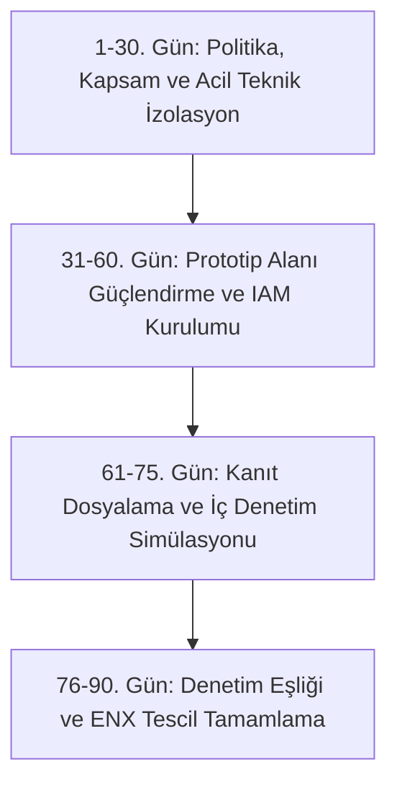

# Örnek TISAX® Hazırlık Senaryosu ve 90 Günlük Eylem Planı

Bu belge; Türkiye'de faaliyet gösteren kurgusal bir otomotiv tedarikçisinin TISAX değerlendirmesine hazırlık sürecini, tespit edilen boşlukları ve 90 günlük GAP kapatma yol haritasını örneklemektedir.

---

## 1. Kurgusal Kurum Profili

- **Firma Adı:** Atlas Otomotiv Sistemleri San. ve Tic. A.Ş. (Kurgusal)
- **Konum:** Kocaeli Gebze OSB Tesisleri (12.000 m² kapalı alan, 350 çalışan)
- **Faaliyet Alanı:** Tier-1 seviyesinde elektrikli araç batarya taşıyıcı şasileri ve yüksek gerilim kablo demetleri üretimi.
- **Müşteri Talebi:** Alman bir OEM ana üreticisi (OEM-X), 2027 model yeni elektrikli platform projesine teklif verilebilmesi için TISAX etiketlerini zorunlu tutmuştur.

---

## 2. Kapsam ve Değerlendirme Hedefleri

### ENX Kayıt Parametreleri:
- **Participant ID (Katılımcı Kimliği):** `PGXXXX`
- **Scope ID (Kapsam Kimliği):** `SXXXXX` (Gebze Tesisleri Tek Lokasyon Standart Kapsam)

### Seçilen Değerlendirme Hedefleri (Assessment Objectives):
1. **Info High (Bilgi Güvenliği - Yüksek Koruma İhtiyacı):** OEM'e ait gizli CAD/CAM çizimleri ve parça maliyet analizleri için. (Gereken Seviye: **AL2**)
2. **Availability High (Yüksek Erişilebilirlik İhtiyacı):** OEM montaj hattına Just-in-Time (JIT) sevkiyat yapıldığı için üretim duruş riskinin önlenmesi. (Gereken Seviye: **AL2**)
3. **Proto Parts (Prototip Parçalar):** Seri üretime girmemiş yeni batarya taşıyıcı prototiplerinin AR-GE alanında üretilip işlenmesi. (Gereken Seviye: **AL3 - Yerinde Denetim**)

> 💡 **Kritik Kural:** Tesis prototip parça (Proto Parts) işlediği için genel denetim seviyesi **AL3 (Yerinde Tesis Ziyareti)** olarak planlanmıştır.

---

## 3. Ön GAP Analizinde Tespit Edilen Kritik Boşluklar

Denetim öncesinde yapılan iç boşluk analizinde 4 ana alanda majör risk tespit edilmiştir:

1. **Ağ İzolasyonu Eksikliği:** Üretim hattındaki kaynak robotları ve pres makineleri (OT), ofis çalışanlarının kullandığı kurumsal yerel ağ (LAN) ile aynı omurga üzerindedir.
2. **Prototip Alanı Güvenliği:** AR-GE prototip atölyesinin pencerelerinde dışarıdan görünmeyi engelleyen film/jaluzi bulunmamakta, giriş kapısı standart anahtarla açılmaktadır.
3. **Bulut Veri Paylaşımı:** OEM'den gelen büyük hacimli CAD dosyaları bazı mühendisler tarafından yetkisiz WeTransfer ve kişisel Google Drive hesaplarıyla paylaşılmıştır.
4. **Yedekleme Güvencesi:** Üretim veri tabanı yedekleri günlük alınmakta ancak fidye yazılıma karşı korumalı (WORM / Air-gapped) yedekleme ve periyodik geri yükleme (restore) testi yapılmamaktadır.

---

## 4. 90 Günlük GAP Kapatma ve Hazırlık Yol Haritası

### Aşama 1: 1–30. Gün — Kapsam Netleştirme ve Acil İzolasyon
- ENX Portalı üzerinde `Participant ID` ve `Scope ID` oluşturulması.
- VDA ISA 6.0.3 uyumlu BGYS Politika ve Prosedür setinin yayımlanması.
- OT ve IT ağlarının endüstriyel firewall ile VLAN bazında ayrılması; robot hatlarının internete doğrudan çıkışının kesilmesi.
- Kurumsal bulut depolama için kurumsal şifreli SFTP / OEM onaylı veri değişim altyapısının devreye alınması; harici dosya paylaşım sitelerinin engellenmesi.

### Aşama 2: 31–60. Gün — Prototip Güvenliği ve Erişim Kontrolü
- AR-GE prototip atölyesine tavan yüksekliğinde bölme duvar, opak cam filmi ve iki faktörlü (Kart + Parmak İzi) geçiş sistemi kurulması.
- Prototip alanına girişlerde cep telefonu ve kayıt cihazı teslim kutularının yerleştirilmesi.
- Tüm VPN ve kritik sunucu erişimlerinde zorunlu MFA (TOTP) zorunluluğunun aktif edilmesi.
- Yedekleme sisteminde AWS S3 Object Lock (değişmez yedekleme) kuralının tanımlanması ve ilk başarılı felaket tatbikatının raporlanması.

### Aşama 3: 61–75. Gün — Kanıt Dosyalama ve İç Denetim Simülasyonu
- Nesnel Kanıt Matrisi'ndeki tüm belgelerin, logların ve ekran görüntülerinin denetim klasöründe toplanması.
- Bağımsız bir danışman gözetiminde 2 günlük kapsamlı denetim simülasyonu yürütülmesi.
- Simülasyonda çıkan minör eksikliklerin (ziyaretçi defteri, temiz masa denetimi vb.) kapatılması.

### Aşama 4: 76–90. Gün — Resmî Değerlendirme ve Etiket Kazanımı
- Akredite TISAX denetim sağlayıcısı (TÜV, DQS, DEKRA vb.) ile sözleşme yapılması ve denetim tarihinin kesinleştirilmesi.
- 1. Gün: Uzaktan dokümantasyon ve inandırıcılık incelemesi (AL2 kontrolleri).
- 2. ve 3. Gün: Gebze tesisinde yerinde fiziksel denetim, AR-GE prototip alanı teftişi ve mülakatlar (AL3 kontrolleri).
- Denetim raporunun ENX Portalı'na yüklenmesi ve OEM müşterisiyle TISAX Etiketlerinin (TISAX Labels) paylaşılması.
